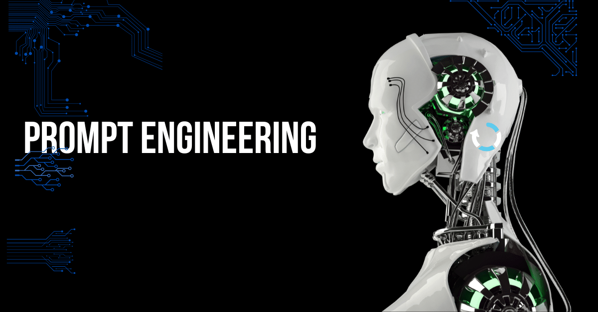

 
  
# holbertonschool-ai4devs  
  
This repository is where offensive security thinking meets AI development. It's a hands-on record of experiments, technical exercises, reusable prompts and projects exploring how AI can help developers work smarter, identify weaknesses earlier and build more secure software.  
  
**The mission**: Understand the technology. Challenge its assumptions. Find the weaknesses. Build something better.  
  
## The Mission  
  
AI is changing how software gets built. I'm here to understand how to use it effectively without switching off the critical thinking that cybersecurity demands.  
  
My focus is on applying AI to real engineering problems, including:  
  
- **Find the weaknesses**: Explore AI-assisted vulnerability analysis, debugging and secure code review.  
  
- **Build with security in mind**: Apply secure coding principles throughout the development lifecycle.  
  
- **Break it before someone else does**: Use AI to develop security tests, probe edge cases and catch regressions.  
  
- **Automate the repetitive**: Investigate AI-powered workflows that reduce manual effort without sacrificing quality.  
  
- **Engineer better prompts**: Design reusable, structured prompts that produce useful and verifiable results.  
  
- **Ship working solutions**: Turn concepts into practical projects and AI-integrated applications.  
  
The objective isn't to blindly trust AI. It's to understand its capabilities, challenge its output and use it as a force multiplier.  
  
## The Training Ground
  
The Holberton School Australia AI Development Accelerator is a project-based program covering AI development, prompt engineering, integration, automation and building AI-powered applications.  
  
The published curriculum is structured around three sprints:  

#### 01 — AI Foundations and Prompt Engineering  
  
Learn to communicate with AI systems effectively and apply them to real development tasks.  
  
- Prompt design and reusable templates  
- AI-assisted debugging and code quality  
- Architecture design and technical specifications  
- Structured problem-solving with AI  
  
#### 02 — Integration and Workflow Automation  
  
Move beyond isolated prompts and explore how AI fits into actual engineering workflows.  
  
- AI integration into development environments  
- Code generation and quality workflows  
- Workflow automation  
- API prototyping and integration  
  
#### 03 — Build and Ship with AI  
  
Put the knowledge to work by developing and delivering an AI-integrated minimum viable product.  
  
- AI-assisted code reviews  
- Application development and integration  
- Testing and refinement  
- Building and shipping a working MVP  
  
Course details: Holberton School Australia — AI Development Accelerator

# What's in This Repository?  
  
This repository documents my progression through the course, from foundational prompt engineering to practical AI-assisted development.  
  
## Prompt Engineering Arsenal  
  
The prompts/ directory contains 15 reusable Markdown templates focused on cybersecurity and secure software development.  
  
Rather than throwing vague instructions at an AI and hoping for the best, these templates define the role, task, required inputs, expected output and intended outcome.  
  
The goal is simple: Better inputs. More useful outputs. Less guesswork.  
  
### Secure Code Quality  
- Secure refactoring  
- Input validation and sanitisation    
- Hardcoded secrets detection  
  
### Vulnerability Analysis and Debugging  
- SQL injection analysis  
- Cross-site scripting (XSS) analysis  
- Authentication and authorisation review  
  
### Security Testing  
- Negative input validation testing  
- Access control testing  
- Security regression testing  
  
### Security Documentation  
- Secure API documentation  
- Threat modelling  
- Security review reporting  

### Dependency and Configuration Security  
- Dependency vulnerability review  
- Secure configuration review  
- Secrets and environment variable management  
  
Every template is designed to be reusable, adaptable and specific enough to guide an AI towards a meaningful deliverable.  
  
## The Method: Prompt. Probe. Verify. Refine.  
  
AI-generated code and security findings are only as useful as the reasoning and verification behind them. 
  
My approach follows a repeatable engineering cycle:  
  
1. **Scope the target**: Define the problem, requirements, assumptions and constraints.  
  
2. **Engineer the prompt**: Give the AI a clear role, precise instructions and relevant context.  
  
3. **Challenge the output** Look for incorrect assumptions, missed edge cases and security blind spots.  

4. **Verify the findings**: Validate recommendations through code inspection, testing and appropriate security references.  
  
5. **Refine the approach**: Improve the prompt, test again and iterate until the result meets the requirements.  
  
No blind trust. No magic-button security. Just disciplined engineering with AI in the toolkit.
  
# Connecting the Dots  
  
**Program**: Holberton School Australia — AI Development Accelerator program.   

**Focus**: AI engineering, prompt engineering, cybersecurity, secure software development and automation.  

**Approach**: Think critically. Test relentlessly. Build securely.     