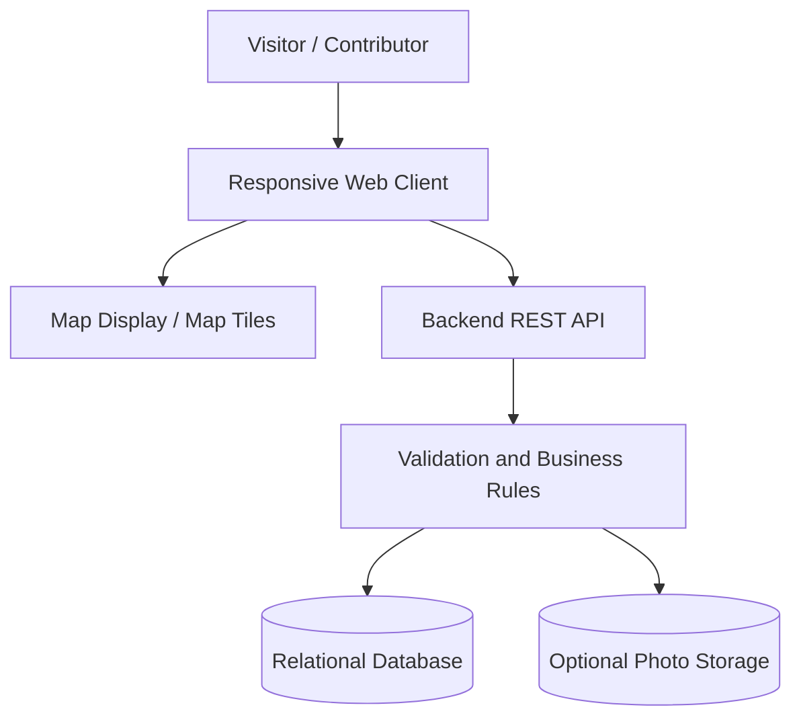

# BLOOM — High-Level MVP Architecture

## Overview
BLOOM uses a responsive client to browse species, display a species-filtered sightings map and submit sightings and comments. A backend API validates requests and persists structured records in a relational database. Optional photos are stored separately, with the database holding their references.

## Components
- **Responsive web client:** Species list, species details, map, filters, sighting submission and comments. The approved BLOOM mobile design system informs the UI.
- **Map display:** Renders map tiles and markers from stored coordinates. Species filters are applied to the sightings returned by the API or in the client for small datasets.
- **Backend REST API:** Exposes species, sightings and comments; returns consistent validation errors.
- **Validation layer:** Checks required fields, supported species, coordinates, dates, comment length and photo constraints.
- **Relational database:** Stores species, sightings and comments with foreign-key relationships.
- **Photo storage (optional):** Stores accepted image files and returns references, avoiding embedding images directly in database rows.

## Illustrative API Routes
| Method | Route | Purpose |
|---|---|---|
| GET | `/api/species` | List or search supported species |
| GET | `/api/species/{id}` | Read species details |
| GET | `/api/sightings?species_id={id}` | List sightings, optionally filtered |
| GET | `/api/sightings/{id}` | Read one sighting |
| POST | `/api/sightings` | Create a validated sighting |
| GET | `/api/sightings/{id}/comments` | List sighting comments |
| POST | `/api/sightings/{id}/comments` | Add a validated comment |

## Primary Flow
1. Visitor opens BLOOM and requests supported species and sightings.
2. Visitor selects a species; the map displays only matching sighting markers.
3. Visitor opens a marker to view the observation date, notes and optional image.
4. Contributor submits a sighting; the API validates and stores it.
5. The new sighting is returned in subsequent map queries.

## Security and Operational Considerations
- Validate all submitted data server-side and escape user-generated content when rendered.
- Apply upload size and file-type restrictions; do not expose storage credentials to the client.
- Rate-limit write endpoints and provide a basic mechanism to handle abusive content before public launch.
- Do not claim that user-submitted sightings are independently verified or current.
- Keep API secrets and database credentials in environment configuration.

## Scope Boundaries
This is a high-level design, not a claim that these components have been implemented or deployed. Provider and framework selection can follow in later tasks.
