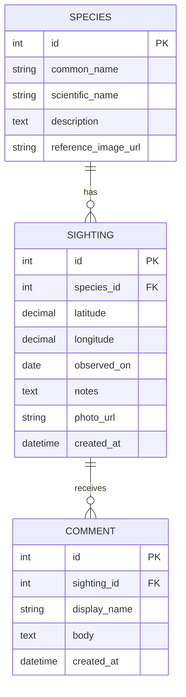

# BLOOM — MVP Data Model

## Entity Relationship Diagram

## 1. Species
Curated plants supported by the MVP.

| Field | Type | Rules |
|---|---|---|
| `id` | Integer | Primary key |
| `common_name` | String | Required, unique |
| `scientific_name` | String | Optional |
| `description` | Text | Required |
| `reference_image_url` | String | Optional |

Initial species: Magnolia, Jacaranda, Wattle and Bottlebrush.

## 2. Sighting
A community-reported observation of a species at a location.

| Field | Type | Rules |
|---|---|---|
| `id` | Integer | Primary key |
| `species_id` | Integer | Required foreign key to Species |
| `latitude` | Decimal | Required, -90 to 90 |
| `longitude` | Decimal | Required, -180 to 180 |
| `observed_on` | Date | Required; not in the future |
| `notes` | Text | Optional; length-limited |
| `photo_url` | String | Optional; reference to approved upload |
| `created_at` | DateTime | Required, server-generated |

## 3. Comment
A visitor's note associated with a sighting.

| Field | Type | Rules |
|---|---|---|
| `id` | Integer | Primary key |
| `sighting_id` | Integer | Required foreign key to Sighting |
| `display_name` | String | Optional, length-limited |
| `body` | Text | Required, non-empty and length-limited |
| `created_at` | DateTime | Required, server-generated |

## Relationships and Constraints
- One Species has zero or more Sightings; each Sighting belongs to exactly one Species.
- One Sighting has zero or more Comments; each Comment belongs to exactly one Sighting.
- Deleting a Species with existing Sightings should be restricted in the MVP.
- Deleting a Sighting should remove or otherwise safely handle its dependent Comments.
- Index `Sighting.species_id`, `Sighting.observed_on` and `Comment.sighting_id` for common queries.

## Deferred Entities
User accounts, moderation reports, pollen alerts and automated identification results are outside the initial three-entity MVP. If authentication becomes required later, a User entity can be introduced explicitly rather than assumed here.
