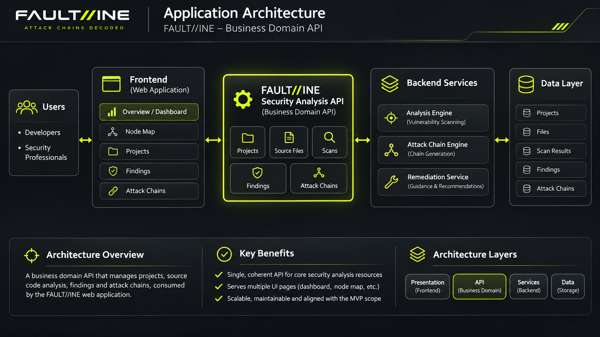

# API Requirements – FAULT//INE Source-Code Security Analysis API
  

  

 
  
## Domain  

Developer-focused application security analysis API for managing Python source-code projects, initiating vulnerability scans and retrieving security findings and potential attack-chain data for visualisation and remediation.

## Target Users  

- **Software Developers**: Primary users who upload source code, review potential vulnerabilities, explore attack chains, and access remediation guidance.  
- **Security Professionals**: Supporting users who provide additional security analysis, validate findings and assist developers with remediation when required.

## Core Operations

1. Create a project.  
2. Retrieve a project by ID.  
3. List projects belonging to the authenticated user.  
4. Update project details.  
5. Delete a project.  
6. Upload an individual Python source file to a project.  
7. List uploaded source files within a project.  
8. Initiate a vulnerability scan for a project.  
9. Retrieve scan status and results by scan ID.  
10. List vulnerability findings for a scan, with filtering and pagination.  
11. Retrieve detailed information and remediation guidance for a finding.  
12. Retrieve potential attack chains, including ordered steps and relationships between findings, for a scan.  

## Data Rules  
  
- Project IDs, file IDs, scan IDs, and finding IDs must be valid identifiers.  
- Required fields must not be empty; project names must contain non-whitespace characters.  
- Uploaded source files must use the `.py` extension.  
- Each uploaded file must be non-empty and must not exceed 5 MB.  
- Multiple individual source files are permitted within a project; folder and bulk uploads are excluded.  
- File content must be treated as untrusted input and must not be executed during upload.  
- Scan requests must reference an existing project containing at least one valid source file.  
- Finding severity must use a defined enumeration, and finding locations must reference valid source files and line numbers.  
- Attack-chain relationships must reference existing findings within the relevant scan.  
- Users must only access projects and associated resources they are authorised to view.  

## Non-Functional  
  
- **Latency**: Target response time below 200 ms for standard metadata retrieval requests, excluding file transfers and scan processing.  
- **Authentication**: JWT authentication required for protected API operations.  
- **Authorisation**: Enforce resource-level access controls for projects, files, scans, findings, and attack chains.  
- **Rate Limits**: Proposed prototype limits of 60 standard API requests per minute and 10 scan initiations per hour per authenticated user.  
- **Validation**: Reject invalid requests with appropriate HTTP status codes and consistent error responses.  
- **Pagination**: Support paginated collection responses to prevent unbounded result sets.  
- **Security**: Use HTTPS for API communication and avoid exposing uploaded source code or sensitive information in error responses.  
- **Scan Processing**: Support asynchronous scan execution with status retrieval rather than requiring scans to complete within standard request latency targets.  
